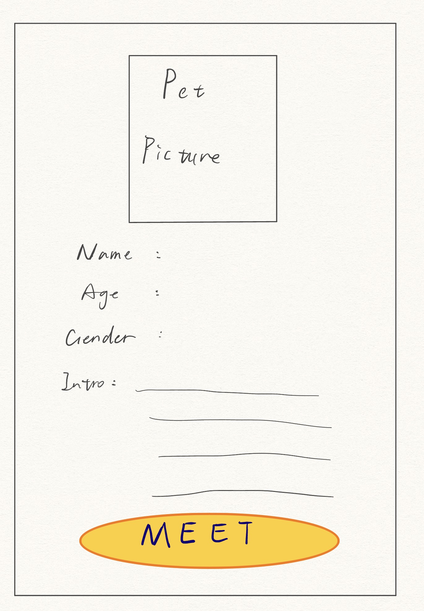

# Pet-profile-card

# Pet Profile Card — Meet Mochi 🐱

## Our project and group members

We are **Luxian Xin and Kate Osorio**. Our project is a pet adoption profile card made with HTML, CSS, and JavaScript for a fictional cat named Mochi. We want visitors who are interested in adopting a pet to quickly understand her basic information and personality, then see a clear next step. Our card is a class prototype, and Mochi’s profile details are fictional.

## Our project links

- [🐾 Try our live website](https://luciaxin061-byte.github.io/Pet-profile-card/)
- [Explore our source repository](https://github.com/luciaxin061-byte/Pet-profile-card)

We can also open `index.html` locally with `style.css` and `mochi.jpg` in the same folder. Our JavaScript is inside `index.html`; we do not have a separate JavaScript file or a build step.

## Our design intentions and rationale

We used a simple vertical card so visitors can read one pet’s story in a clear order: photo, name, age, gender, location, introduction, personality tags, and the final “Meet Mochi” button. Our photo and name introduce Mochi first, while the aligned information labels help visitors find basic details quickly. Our introduction adds her interests, including sunny windows, soft blankets, and feather toys. Our “Gentle,” “Curious,” and “Playful” tags make her personality easy to scan.

We kept the warm cream and brown palette and the “Meet Your New Friend” heading suggested by ChatGPT because we felt they looked harmonious and welcoming. Our yellow, oval “Meet Mochi” button follows our sketch and stands out as the intended next step. It is currently a placeholder, as we explain below.

We chose a real cat photo instead of the AI-provided cartoon illustration because we wanted visitors to feel more connected to Mochi. We changed “Intro” to “Introduction” for clarity and increased the Name, Age, Gender, Location, and Introduction labels from 14px to 17px for readability. We also chose Caveat at weight 600 for Mochi’s name to give it a more personal, handwritten feeling. Our photo-click interaction is intended to help visitors learn about her beyond a still image, although our current version needs a video selected from the visitor’s device.

### Our original sketch

We included the sketch already supplied during our project, rather than creating a new image as evidence. Our finished card keeps its main order and adds a status line, location, personality tags, and a video dialog.

## Our AI learning and human decisions

We used ChatGPT as a thinking partner to adapt our webpage assignment into a pet profile card. ChatGPT suggested the initial layout and starter HTML/CSS, and helped translate our later requests into code. Our decisions were to keep the warm palette and heading, use our sketch for the layout, replace the cartoon with a real photo, clarify the wording, enlarge the labels, and request the photo-click video interaction. We evaluated the suggestions against our goal of making Mochi easy to understand rather than accepting every initial choice.

Our iterations helped us connect design decisions with code. Replacing the illustration showed us how an HTML image changes the feeling of the card. Adjusting CSS font sizes helped us think about readability, while changing “Intro” showed us that wording is also part of the interface. We removed “Choose a video of Mochi from your device to watch it here.” because we thought it sounded like a developer instruction rather than visitor-facing content. Our dialog still keeps the file chooser’s label and the explanation that a selected video stays on the device.

We also learned to distinguish a coded interaction from a fully tested experience. We reviewed the dialog, but we did not have a suitable Mochi video to test the intended viewing experience completely. We cannot claim that video playback succeeded just because the event handlers exist. Our recorded history supports these specific revisions; we have not documented additional experiments, failed prompts, or measured usability results.

## Our code implementation

| Our choice | How our actual code expresses it |
| --- | --- |
| A clearly organized pet profile | We use `<main>` and `<article class="pet-card" aria-labelledby="pet-name">` for the card, an `<h1>` for Mochi’s name, a `<dl>` with `<dt>`/`<dd>` pairs for age, gender, and location, and labeled sections for the introduction and personality. |
| A photo that also opens an interaction | We place `` inside `<button class="pet-avatar">`. Our image has descriptive alt text, and our button has an accessible name, `aria-haspopup="dialog"`, and a connection to the dialog through `aria-controls`. Our `.pet-avatar img` rule uses `width: 100%` and `height: auto` to preserve the photo’s proportions. |
| Aligned labels and scannable tags | We use CSS Grid for `.name-row`, `.pet-details > div`, and `.intro`. Our `.traits` list uses wrapping Flexbox and rounded borders so the personality words appear as separate tags. Our CSS `::after` rules add the label colons. |
| Our colors and typography | We use `#fffdf7` for the card, brown text, and `#ffd348` for the meeting button. Our label selector sets `font-size: 17px`; our `h1` uses `"Caveat", cursive` and `font-weight: 600`. We load Caveat through Google Fonts. |
| A layout intended for smaller screens | We set a 560px maximum card container width and use `@media (max-width: 480px)` to reduce padding, photo width, label-column width, and the name size. These rules express our responsive intent; their presence alone does not prove the layout works on every device. |
| Opening and closing our video dialog | Our photo button’s `click` handler calls `videoDialog.showModal()`. Our close-button handler calls `.close()`, and our dialog click handler closes it when a click is outside its bounds. Our native `<dialog>` also supports Escape. In our `close` handler, we pause the video, reset its time when media is ready, and return focus to the photo button. |
| Selecting a local video | Our file input uses `accept="video/*"`. In its `change` handler, we inspect the selected file’s type, with an extension fallback when its type is empty, then use `URL.createObjectURL(file)` as the video source. We revoke the previous object URL when replacing a video, show the player, and attempt playback. Our controls remain available when automatic playback is blocked, and our video `error` handler displays a message if playback fails. |
| Visible keyboard focus | We include `:focus-visible` outlines for buttons and the file input. Our video has native playback controls and `playsinline`. We still need broader keyboard and assistive-technology testing before making accessibility claims. |

## Our testing and revisions

### Our earlier group review

We report that we reviewed the photo-click interaction and video dialog in **Chrome and Safari**, and that they worked in our review. We did not have a suitable Mochi video, so this does **not** establish successful video playback. We have not recorded browser versions, devices, screen sizes, or detailed test steps.

Our documented revisions were replacing the cartoon with a photo, changing “Intro” to “Introduction,” enlarging the five labels, changing the name font, adding the dialog and local video selector, and removing the placeholder sentence. We connect these revisions to clarity and our intended experience; we do not have before-and-after usability measurements.

### Our checks during this README review

We used AI-assisted checks during this documentation review, separately from our earlier group testing:

- We compared our local `index.html` and `style.css` with the files on GitHub: both matched byte for byte. Our local photo matched the repository’s Git blob hash.
- We requested our live website: it returned **HTTP 200**, and its HTML matched our local HTML.
- We checked HTML element nesting, duplicate IDs, local asset paths, and ID references used by labels and ARIA attributes: these checks passed. Our CSS brace-balance check passed. These were structural checks, not full HTML/CSS validation or an accessibility audit.
- We compiled our inline JavaScript with Node’s `vm.Script`: its syntax check passed. This check did not execute our event handlers.
- We checked our published site in the Codex in-app browser: clicking our photo opened the dialog; our close button and Escape each dismissed it and returned focus to the photo button. Clicking “Meet Mochi” produced no visible change, consistent with our source code having no handler for it.

We did not select a video or test playback, file replacement, invalid-file handling, playback-error messages, backdrop-click dismissal, mobile layouts, or screen readers during this review. We have not independently repeated our Chrome/Safari review. We changed documentation and added our existing sketch file; we did not change our application code during this review.

## Our limitations and future interaction

Our **“Meet Mochi” button does not currently open a form or navigate anywhere**. It is a `type="button"` with no JavaScript handler, and our prototype note explains that meeting requests are unavailable. Our prototype does not collect or save names, contact details, or meeting times. In a future version, we plan for the button to open a meeting request form asking for those details; validation, submission, and storage are not implemented.

Our video dialog is implemented, but we have not supplied a Mochi video. Our current file selector makes a temporary local preview; it does not upload a video to a server or share it with other visitors, and we need to select a file again after refreshing. We also rely on a network connection for the Caveat font, with a cursive fallback.

We identified two interface improvements to consider without changing the code in this review: we could make our photo hint explain that a local video must be selected, or supply a suitable video so the existing hint matches the experience. We could also make our meeting button’s unavailable state clearer until our form exists. These are suggested next steps, not completed fixes or observed playback bugs.

## Our image credit and remaining evidence

We found our Mochi photo through Google Images. Our supplied source link points to [Carolina Veterinary Specialists, “Best Breed of House Cat”](https://www.greensboro.carolinavet.com/site/greensboro-specialty-veterinary-blog/2023/03/15/how-to-choose-cat-breed), with [this image URL](https://d2zp5xs5cp8zlg.cloudfront.net/image-79322-800.jpg). We are identifying our source here; we have not established the original photographer or a reuse license from our project record.

Before our final submission, we still need to answer: **Which devices, browser versions, and screen sizes did we use for our Chrome and Safari review, and which actions did we check? What photographer credit and reuse terms accompany our photo source?** We also need a suitable Mochi video before we can complete and document playback testing. We have included our existing sketch, so we do not currently need to supply a screenshot as a substitute.

